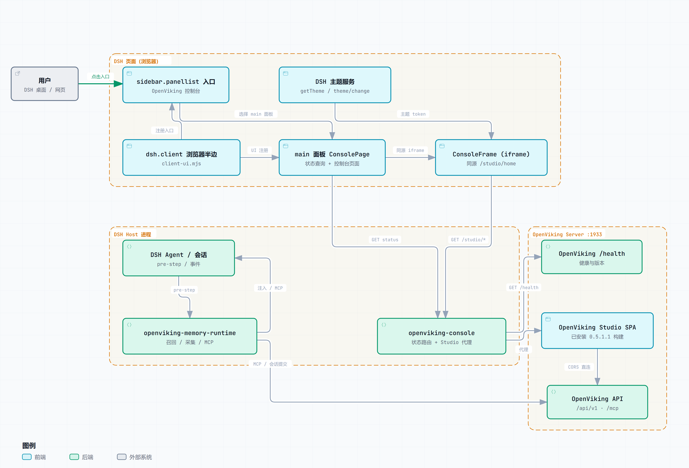

# OpenViking 控制台（DSH 预览版）

[English](README.en.md) | **简体中文**

[](https://github.com/deepseek-ai/deepseek-harness)

在 DSH 左侧栏加一个 **OpenViking** 入口，点开在 DSH 中间列直接嵌入 OpenViking 服务端的 Studio，右下角悬浮刷新/在浏览器打开。它是 [volcengine/OpenViking#6435](https://github.com/volcengine/OpenViking/pull/6435) 中控制台组件的独立预览版；PR 合并后请改用记忆插件内置的控制台并卸载本预览。

> **不要和记忆插件内置的控制台同时安装。** 两者都会注册 `/openviking/console`、`/studio/*` 和 `openviking-console` 侧栏入口。



## 功能

- DSH 左侧栏的 **OpenViking** 入口，与插件、自动化任务、上下文洞察并列。
- 在中间列嵌入服务端自己的 Studio；iframe 经同源 `/studio/*` 代理，读得到文档，跟随 DSH 的 `--dsw-alias-*` 主题（亮/暗）。
- 悬浮刷新、在浏览器打开；切到别的侧栏面板时自动切换。
- 受保护的 `/openviking/console` 状态路由；API key 不进浏览器，代理也不转发 OpenViking API。
- `endpoint`（Host/API 地址）和 `consoleUrl`（浏览器访问的 Studio 地址，默认等于 `endpoint`）可配。

## 环境要求

- DSH Web 或 Desktop（支持浏览器半边）。
- OpenViking 服务端在 `/studio` 提供 Studio（0.5.x 的桌面版默认有）。
- 浏览器能访问 OpenViking API（`endpoint`）；服务端需要允许 DSH 源跨域，供 Studio 自己发 API 请求。
- 代理只提供静态 HTML/资源；需要认证时在 Studio 自己的连接页登录。

## 安装

### 方式一：npm 包名（发布后，推荐）

在 DSH 的“添加插件”窗口输入框填包名：

```
dsh-openviking-console
```

安装源保持“中国大陆镜像源”或默认都可以；点“安装”后到插件列表确认“OpenViking 控制台”已启用；重启或刷新 DSH，左侧栏出现 OpenViking 入口。

### 方式二：GitHub 仓库地址 / 本地目录

在“添加插件”窗口粘贴仓库地址 `https://github.com/zrwangems/dsh-openviking-console`。如果直接贴 GitHub 地址安装失败（部分 DSH 版本只接受本地目录），先克隆，再把目录路径贴进去：

```bash
git clone https://github.com/zrwangems/dsh-openviking-console.git
```

### 方式三：命令行

```bash
git clone https://github.com/zrwangems/dsh-openviking-console.git
cd dsh-openviking-console
dsh plugin install .
```

## 配置

安装后有一个 `openviking-console` 组件行，默认连本机 1933 端口：

```yaml
- id: openviking-console
  config:
    endpoint: http://127.0.0.1:1933
    # 可选：控制台地址和 API 地址不同时填
    consoleUrl: https://console.example/openviking
```

`endpoint` 是 Host 侧 API 地址：状态路由探测 `${endpoint}/health`，代理在未设置 `consoleUrl` 时回退到它，注入进 Studio 的连接配置也用它。`consoleUrl` 是浏览器访问控制台的地址（可以是 base 或完整的 `/studio/home` URL），默认等于 `endpoint`，也可用 `OPENVIKING_CONSOLE_URL` 设置；`endpoint` 也可用 `OPENVIKING_URL`/`OPENVIKING_BASE_URL` 设置。

如果同时装了 `@openviking/dsh-memory-plugin`，它的 `openviking-memory-runtime` 行有自己的配置；需要两个组件连同一个服务端时，把自定义的 `endpoint` 也配到 `openviking-console`。

## 工作原理

- `index.mjs`：Host 插件，解析 `endpoint`/`consoleUrl`，提供最小 `/health` 客户端。
- `console.mjs`：受保护的 `/openviking/console` 状态路由、同源 `/studio/*` 代理，以及把连接 bootstrap 注入代理回来的 Studio HTML。
- `client-ui.mjs`：浏览器半边（`dsh.client`），侧栏入口、主面板、`/studio/home` iframe、主题注入、悬浮按钮。

Studio 通过代理与 DSH 同源，浏览器半边能直接读到它的文档并写入宿主主题；Studio 的 API 请求直连配置的 `endpoint`，代理只提供 HTML/资源。

## 安全说明

- 代理不携带 OpenViking API key，也不转发 API 请求。
- 状态路由带 DSH 的浏览器信任校验；只返回连接/状态元数据。
- 服务端需要认证时，由 Studio 自己的连接页登录。
- 插件占用 DSH 同源的 `/studio` 路径（Studio 构建时使用的 base）。

## 预览说明

- 本仓库是 [volcengine/OpenViking#6435](https://github.com/volcengine/OpenViking/pull/6435) 的预览；上游把控制台作为 `@openviking/dsh-memory-plugin` 的第二个 Host 组件，随记忆插件版本发布。
- 托管/分离部署可以把 `consoleUrl` 指向独立控制台地址，Studio 的 API 仍走 `endpoint`。
- 上游 PR 发布后，请先卸载本预览，再升级记忆插件。

## 许可证

插件代码取自 [OpenViking](https://github.com/volcengine/OpenViking) 仓库，按 GNU Affero General Public License v3.0（AGPL-3.0）分发，见 [LICENSE](LICENSE)。OpenViking 及其标识归其各自所有者。

[](https://github.com/deepseek-ai/deepseek-harness)
